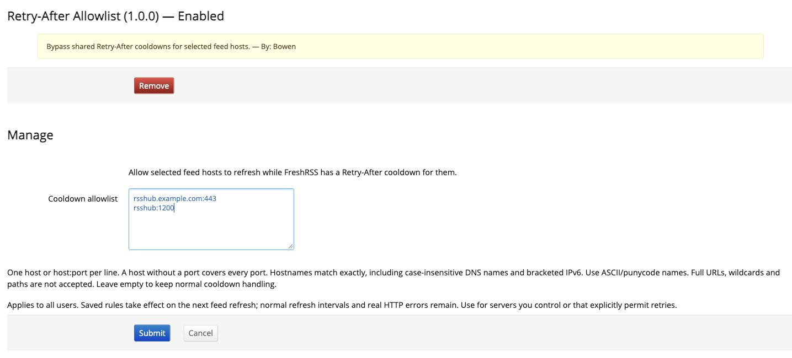

# FreshRSS 冷却白名单

[English](README.md)

[](https://github.com/bowencool/xExtension-RetryAfterAllowlist/actions/workflows/ci.yml)

[](LICENSE)

让指定的订阅主机跳过 FreshRSS 的共享 `Retry-After` 冷却。适用于自建 RSSHub 等服务：一条路由报错后，同域名下原本正常的其他订阅仍能按正常刷新间隔继续更新。

例如 RSSHub 的某条路由返回 `503`，FreshRSS 给整个主机记录了冷却时间，其他订阅就算在浏览器中能打开，也会暂时停止抓取。把你自己的 RSSHub 主机加入白名单，可以解除这个限制。

**默认白名单为空**。这是系统扩展，只有管理员能配置，对所有用户生效。



## 环境要求

- FreshRSS **1.30.0 及以上**，已在 **1.30.1** 上进行集成验证。
- PHP **8.1 及以上**，以及 FreshRSS 正常运行所需的依赖。
- FreshRSS 数据目录可写。

## 安装

1. 把仓库克隆到 FreshRSS 的持久化第三方扩展目录：

   ```sh
   cd "/path/to/persistent/extensions"
   git clone https://github.com/bowencool/xExtension-RetryAfterAllowlist.git
   ```

   也可以从 [Releases](https://github.com/bowencool/xExtension-RetryAfterAllowlist/releases) 下载 `xExtension-RetryAfterAllowlist.zip`，解压到该目录。扩展文件夹中应直接包含 `metadata.json` 和 `extension.php`。

2. 管理员登录，进入 **管理 → 扩展**，启用 **Retry-After Allowlist**。
3. 打开扩展设置，每行填写一个主机名或 `主机名:端口`，然后保存：

   ```text
   rsshub.example.com:443
   rsshub:1200
   ```

4. 刷新白名单内的订阅，扩展会在刷新前清除已有冷却。保存设置本身不会抓取订阅，也不会直接改掉订阅的错误状态。

LinuxServer.io 镜像通常使用 `/config/www/freshrss/extensions`；官方 FreshRSS 镜像的第三方扩展目录为 `/var/www/FreshRSS/extensions`。请按镜像的卷挂载说明使用持久化目录，否则替换容器时扩展文件会丢失。

## 匹配方式

| 填写内容 | 生效范围 | 不匹配 |
| --- | --- | --- |
| `rsshub.example.com:443` | 该主机的 HTTPS 默认端口及显式 443 端口 | 80、8443 端口及子域名 |
| `rsshub.example.com` | 该主机的所有端口 | 其他主机及子域名 |
| `rsshub:1200` | 该 Docker / 内网主机的 1200 端口 | 其他主机或端口 |
| `[2001:db8::1]:8443` | 该 IPv6 地址的 8443 端口，支持等价写法 | 其他 IPv6 地址 |

域名精确匹配，不区分大小写，忽略末尾的一个 DNS 根点。URL 未写端口时，HTTP 使用 80，HTTPS 使用 443。支持 IPv4 和带方括号的 IPv6；国际化域名请使用 ASCII/punycode。忽略空行和以 `#` 开头的注释行。

不接受完整 URL、用户名密码、路径、通配符或无效端口。界面提交有误时保留之前保存的规则；如果手工编辑的配置有误，则该请求不跳过任何冷却。

## 工作方式与限制

- 使用 FreshRSS 的公开 `getRetryAfter` / `setRetryAfter` API，在刷新前和 SimplePie 初始化前后清除冷却，不修改核心文件，不自己推算冷却文件名。
- 正常刷新间隔、缓存和网络请求仍由 FreshRSS 管理，不增加立即重复请求的循环。
- 真实的 `429`、`503` 仍然显示为订阅错误。扩展清除相应冷却，让同主机其他订阅或下次定时刷新有机会继续。
- 处理订阅单独设置的代理和系统代理，对不相关的代理记录不做修改。
- 规则针对订阅中配置的 **Feed URL**。跳转到其他主机、自动发现资源、图标及其他 HTTP 操作产生的冷却不在此扩展处理范围内；适用时可直接使用最终订阅地址。
- 公网主机可能共享冷却，内网主机可能按 URL 区分，具体由 FreshRSS 自己决定。并发请求可能在钩子之间短暂产生冷却；扩展没有替换全局 HTTP 请求逻辑。
- 建议用于自己管理的服务器或明确允许重试的服务；第三方服务仍应遵循其限速要求。

## 更新与停用

Git 安装可在扩展目录运行 `git pull --ff-only`；压缩包安装则替换为新版文件。白名单保存在 FreshRSS 系统配置中，不放在扩展源文件里。数据目录和扩展目录正确持久化后，更新插件或替换容器都能保留配置。

停用插件或把白名单留空，即恢复正常的冷却机制。已清除的旧冷却不会重建，之后的失败响应仍能正常生成新冷却。订阅恢复后成功刷新，错误状态会由 FreshRSS 正常清除。

## 开发

不需要额外安装 Composer 或 JavaScript 依赖。

```sh
php "tests/run.php"
find . -type f \( -name '*.php' -o -name '*.phtml' \) -print0 | xargs -0 -n1 php -l
```

在已配置的 FreshRSS 安装中运行集成测试：

```sh
FRESHRSS_PATH="/path/to/FreshRSS" php "tests/integration.php"
```

请使用 FreshRSS 应用用户运行。测试只为随机的 loopback URL 创建冷却元数据，不发送 HTTP 请求，配置改动仅在内存中生效，最后自动清理测试记录。覆盖白名单与非白名单、端口边界、代理区分、失败抓取后的清理和无效配置。

CI 在 PHP 8.1、8.3、8.5 上检查语法和匹配逻辑。推送 `v` 开头的标签后，检查通过才会发布可安装的 ZIP。

配置界面和仓库结构参考 [Broad Site Icon Fetcher](https://github.com/bowencool/xExtension-BroadIconFetcher)。欢迎提交可复现的问题和改进。

## 许可证

[AGPL-3.0](LICENSE)。
